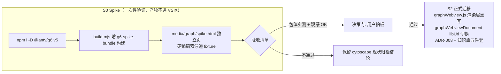

# 可视化画布渲染库迁移方案（cytoscape → AntV G6 v5）

> **状态**：待决策（S0 Spike 未启动）
> **关联变更**：#G6-MIGRATION
> **关联文档**：`docs/adr/007-cytoscape-build-time-bundle.md`（将被 ADR-008 修订）、`docs/knowledge-base/boundaries.md`（画布能力行）
> **起草日期**：2026-10-07

---

## 1. 背景与动机

v1.3.0 画布采用 cytoscape.js + cytoscape-dagre（ADR-007）。实际使用中暴露的核心问题：

1. **文字与形状错位**：`width: label / height: label` 自适应路径依赖 canvas 字体度量，对 CJK 长描述测量失灵，标签逃出节点形状，出现"空框 + 悬浮文字"的观感缺陷（三轮样式修正均无法根治）。
2. **样式手调成本高**：canvas 渲染不支持 CSS 变量，主题适配全靠硬编码色值逐项调。
3. **能力缺口**：悬浮 tooltip（截断后完整信息回看）、节点内富内容、内置状态动画等均需手写大量胶水代码。

## 2. 选型结论

**AntV G6 v5**（备选 React Flow / D3 / vis-network 已评估）：

| 诉求 | G6 v5 对应能力 |
|------|---------------|
| 文字进框 | 节点标签自适应几何计算，CJK 度量正常；亦支持 HTML 类型节点 |
| 代码简单 | combos 直接映射泳道/引用分组；内置 dagre 布局（省掉 dagre 插件）；tooltip/小地图/图例为内置插件 |
| 功能强大 | 状态动画（Live 脉冲）、hover 交互态、事件体系均为一等公民 |
| 不引入框架 | 纯 JS API，无需 React 构建链（React Flow 路线需要） |

## 3. 影响分析

| 检查项 | 是否影响 | 说明 |
|--------|---------|------|
| 违反约束/不变量 | 可能 | GR-012 零 CDN 仍成立；**GR-001 VSIX ≤500KB 待实测裁决**；INV-028 只读投影不变 |
| 新增业务能力 | 否 | 纯渲染层替换，快照/协议/命令零变化 |
| 修改业务规则/状态流转 | 否 | — |
| 修改能力契约/接口契约 | 否 | `buildGraphSnapshot` 输入输出不变 |
| 修改模块职责 | 是 | `media/graph/graphWebview.js` 渲染实现整体换库 |
| 影响其他模块 | 是 | `build.mjs`（新增 g6 bundle 构建项）、`graphWebviewDocument.ts`（libUri）、ADR-007、boundaries/glossary/architecture |
| 新增/修改测试 | 是 | GR-012 守卫需确认覆盖新 bundle 文件名；现有单测不覆盖 webview 渲染层 |

**模型调度**：命中复杂信号 C6（架构约束变更）——执行阶段建议 GLM5.3。

## 4. 批次设计

### S0 Spike 验收清单（硬性）

1. **文字进框**：CJK 单行标签自适应节点几何，零错位
2. **泳道**：combos 复合节点还原 lane/ref-group 嵌套
3. **布局**：内置 dagre 等价还原 TB 执行流
4. **脉冲**：Live 命中节点呼吸动画（替代现有 border 改色做法）
5. **交互**：缩放/平移/点击节点回调契约等价
6. **包体**：`npm run package` 实测 VSIX 总量 ≤500KB（tree-shake 按需注册）

### S2 正式迁移范围（决策通过后）

| 文件 | 变更 |
|------|------|
| `media/graph/graphWebview.js` | 渲染层重写为 G6（快照/协议/消息处理保留） |
| `src/ui/views/graphCanvas/graphWebviewDocument.ts` | libUri 指向 g6-bundle.js |
| `build.mjs` | cytoscape-bundle → g6-bundle 构建项替换 |
| `package.json` | cytoscape/cytoscape-dagre 移除，@antv/g6 以 devDependency 构建期打包（延续 ADR-007 模式） |
| `docs/adr/008-*.md` | 新 ADR 记录取代决策 |
| 知识库五件套 | boundaries / glossary / flows / architecture / e2e-scenarios 同步 |

### 任务范围锁定

- **本次做**：S0 spike → S1 决策门 →（通过后）S2 迁移
- **本次不做**：命中轨迹时间线 SVG 部分迁移（保留现状）、新业务功能、断点编辑能力

## 5. 风险分析

| 风险 | 应对 |
|------|------|
| G6 包体超 500KB 门禁 | 按需注册（不 import 全量）、esbuild tree-shake；超限即决策门否决，零沉没成本 |
| 迁移期两套 bundle 并存臃肿 | spike 产物不进 VSIX（.vscodeignore 临时排除），S2 完成后移除 cytoscape 依赖与构建项 |
| 命中轨迹重映射（nodeId 契约） | 快照 id `{ownerScene}#{index}` 不变，仅新增到 G6 nodeId 的转换层 |
| 回归风险 | S2 单独提交批次；GR 全量守卫 + 59 套件回归 |

## 6. 回滚方案

S0/S2 均为独立提交批次；S2 后如需回退，git revert 单提交即可回到 cytoscape（cytoscape 构建路径保留至 S2 验收后移除）。

## 7. 变更记录

| 日期 | 变更内容 | 变更人 | 关联变更 |
|------|----------|--------|----------|
| 2026-10-07 | 初稿：选型结论、批次设计、风险与回滚 | GLM-5.3-Flash | #G6-MIGRATION |
