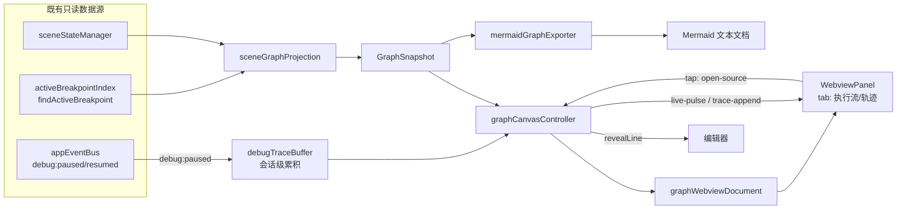

# v1.3.0 场景断点可视化（Visual Graph & Canvas）详细设计

> 状态：待评审 → 待开发 | 对应 roadmap v1.3.0 第 5 项
> 修订记录：R2 渲染层改选 cytoscape+dagre（用户裁决"成熟第三方优先"）；R3 图类型定稿为"执行流 DAG + 命中轨迹"双视图（引用图后置为扩展点，轨迹为会话级易失）
> 设计原则：成熟第三方优先（ADR-007）、只读投影、事件驱动刷新（INV-028）、最小充分复杂度

---

## 0. 渲染选型决策（R2）

### 0.1 实测数据（工具留档，禁止心算臆断）

测量环境：Node v24.0.0，esbuild bundle --minify --format=iife，2026-10-07。

| 方案 | 版本 | minify 产物 | zip 压缩后 | 结论 |
|---|---|---|---|---|
| mermaid 全量 | 12.1.0 | **5130.1 KB** | — | ❌ 击穿 GR-001，webview 解析 5MB 脚本首开卡顿 |
| cytoscape | 3.34.3 | 433.4 KB | — | 备选 |
| **cytoscape + cytoscape-dagre** | 3.34.3 / 4.0.1 | **478.6 KB** | **154.2 KB** | ✅ 选定 |

复测命令（临时目录执行）：

```bash
npm i mermaid cytoscape cytoscape-dagre esbuild
npx esbuild entry.mjs --bundle --minify --format=iife --outfile=out.js   # entry: import cytoscape; import dagre; cytoscape.use(dagre)
```

### 0.2 VSIX 体积核算（GR-001 合规性）

- 当前 VSIX ≈ 130 KB（zip）；VSIX 本质为 zip，webview 资源按压缩体积计入；
- 预估增量：lib 压缩 154.2 KB + 本插件代码压缩 ≈ 6 KB ≈ **160 KB**；
- 预估总 VSIX ≈ **290 KB ≤ 500 KB** —— GR-001 门禁原值保留；
- 兜底：B4 批次 `vsce package` 实测，逼近 500 KB 则裁剪优化；
- **B4 实测留档**：VSIX = **327.13 KB ≤ 500 KB**，GR-001 达标（R4 偏离 ⑧：预估 290 KB，差异来源为本插件新模块源码与 webview HTML 模板压缩体积高于粗估）。

### 0.3 决策

- **渲染引擎**：cytoscape + cytoscape-dagre（执行流 DAG 分层布局）；**命中轨迹时间线**为简单散点连线，webview 内联 SVG 直渲（无需图形库介入）；
- 以 **devDependency** 引入，构建期打包进 `media/graph/cytoscape-bundle.js`（生产 `dependencies` 保持为空，"零外部生产运行时依赖"纪律不破坏，ADR-007 记录）；
- **禁 CDN**：全部本地资源（GR-012）；
- **Mermaid 降级为纯导出格式**：运行时不引入 mermaid（§7）。

---

## 1. 图类型功能定稿（R3 核心）

### 1.1 两个视图：一个看"打算怎么执行"，一个看"实际怎么执行"

| 视图 | 数据性质 | 回答的问题 | 状态 |
|---|---|---|---|
| **执行流 DAG** | 静态声明（展开态步骤流） | 排查链路的空间结构与流向；Live 点亮当前进度 | 常驻 |
| **命中轨迹时间线** | 动态运行记录（debug:paused 累积） | 循环跑了几轮各经过哪些断点？哪个断点从未命中？命中顺序与声明不符说明有未知控制流 | 调试会话期间累积 |

两视图在 webview 内 **tab 切换**，共享节点身份（轨迹条目直接引用执行流节点 id）。

### 1.2 目标

| # | 能力 | 验收口径 |
|---|------|----------|
| G1 | 全景画布：激活场景集展开态图形化呈现（含引用嵌套分组） | 打开 ≤1s，节点与展开态断点流 100% 一致 |
| G2 | 点击直达源码 | 目标行视口居中 + 装饰高亮 |
| G3 | 执行流 Live 点亮：`debug:paused` 命中节点脉冲 | 命中 ≤100ms 进入脉冲态；恢复即刻熄灭 |
| G4 | 一键 Mermaid 导出 | 输出可被 Mermaid 渲染器直接渲染 |
| G5 | 命中轨迹时间线：会话内累积命中记录，横向时间轴呈现 | 每次 paused 追加一轨迹点；terminated 清空 |

### 1.3 非目标（显式排除）

- ❌ 静态 UML 序列图（泳道=文件、箭头=调用）：静态数据只有声明顺序，无调用因果关系，画出来误导排查；
- ❌ 轨迹跨会话持久化：会话级易失（用户裁决），不扩展 JSON Schema、零新增持久化路径；
- ❌ 场景引用图：后置为 §9 扩展点（真数据但低频，非首版负担）；
- ❌ 画布上编辑断点 / 图片导出 / 力导向布局 / 多根工作区（同前）。

---

## 2. 总体架构

### 2.1 分层归属

```text
src/shared/utils/mermaidGraphExporter.ts        【纯函数】GraphSnapshot → Mermaid 文本（导出专用）
src/application/sceneGraphProjection.ts         【应用层】只读投影构建（无写副作用）
src/application/debugTraceBuffer.ts             【应用层】会话级命中轨迹缓存（订阅 appEventBus 累积）
src/ui/views/graphCanvas/
    graphMessageProtocol.ts                     【UI】postMessage 协议类型（纯类型）
    graphWebviewDocument.ts                     【UI】HTML 文档生成（纯函数，可单测）
    graphCanvasController.ts                    【UI】WebviewPanel 生命周期 + 协议路由 + 事件订阅
media/graph/cytoscape-bundle.js                 【构建产物】esbuild 打包 cytoscape+dagre
scripts/build-graph-bundle.mjs                  【构建脚本】产出 cytoscape-bundle.js
src/ui/commands/graphCommands.ts                【UI】命令入口（showGraph / exportMermaid）
```

- `ui → application`（读投影/轨迹）✓；`ui → shared`（导出）✓；零 Infra 依赖、零新增端口、**零新增写盘路径**；
- cytoscape 仅存在于 webview 沙箱，扩展主进程零依赖；
- `debugTraceBuffer` 对齐 `debugPauseContext` 先例（v1.2.0）：应用层小状态实体，事件驱动写入/清除。

### 2.2 协作关系



---

## 3. 数据模型

### 3.1 GraphSnapshot（静态执行流，同 R2）

```typescript
// src/ui/views/graphCanvas/graphMessageProtocol.ts
export interface GraphSnapshot {
	readonly workspaceRoot: string;
	readonly activeScenes: readonly string[];
	readonly lanes: readonly GraphLane[];
	readonly warnings: readonly GraphWarning[];
}
// GraphLane { id: "scene:{name}", sceneName, layer: team|local, nodes: GraphNode[] }
// GraphNode { id: "{ownerScene}#{index}", kind: breakpoint|scene-ref, ownerScene, refPath,
//             file?, line?, functionName?, bpType, desc?, enabled, status: idle|unmatched }
// GraphWarning { code: dangling-ref|disabled-ref, refName, refPath }
```

要点不变：纯只读字段拷贝（实体引用零回写）、id 稳定、`refPath` 驱动引用分组、Live 状态不重算快照。

### 3.2 TraceRecord（命中轨迹，R3 新增）

```typescript
// src/application/debugTraceBuffer.ts
export interface TraceRecord {
	/** 命中序号（会话内单调递增） */
	readonly seq: number;
	/** 对应执行流节点 id（经 activeBreakpointIndex.findActiveBreakpoint 匹配；未匹配记 null） */
	readonly nodeId: string | null;
	readonly file: string;
	readonly line: number;
	/** 相对会话起点的毫秒时间戳 */
	readonly ts: number;
}
```

### 3.3 debugTraceBuffer 生命周期（会话级易失）

```text
调试会话开始(无操作) --debug:paused{file,line}--> 追加 TraceRecord(seq++, findActiveBreakpoint 匹配 nodeId)
任意时刻 --getRecords()--> 只读副本
debug:resumed(不清空, 轨迹跨多次暂停累积)
调试会话 terminated --> clear() 全量清空
```

- 订阅/退订随 `init()`/`dispose()` 成对（由控制器在面板打开时 init、扩展卸载时 dispose）；
- **不落盘、不入 debug-scenes.json**（用户裁决：会话级易失）；
- 轨迹只增不改，天然幂等，无需 SerialQueue（纯内存 append + 快照读取）。

---

## 4. postMessage 协议（双向）

```typescript
// 宿主 → webview
type HostToWebviewMessage =
	| { type: "render"; snapshot: GraphSnapshot }          // 全量渲染（打开/场景变更）
	| { type: "view"; tab: "flow" | "trace" }               // tab 切换
	| { type: "live-pulse"; nodeId: string }               // 执行流节点脉冲
	| { type: "live-clear" }
	| { type: "trace-append"; record: TraceRecord }        // 轨迹增量追加
	| { type: "trace-clear" };                              // 会话结束清空

// webview → 宿主
type WebviewToHostMessage =
	| { type: "open-source"; nodeId: string }              // 点击节点/轨迹点跳转
	| { type: "switch-tab"; tab: "flow" | "trace" }         // 用户切 tab（记录展示态）
	| { type: "export-mermaid" }                            // 画布内导出按钮（R4 偏离 ②：走宿主命令通道）
	| { type: "ready" };
```

webview 侧脚本零业务逻辑：执行流 cytoscape 渲染、轨迹时间线 SVG 直渲（散点+连线，无图形库）。

---

## 5. 布局与渲染设计

### 5.1 执行流 DAG（cytoscape，同 R2）

- 场景泳道 = compound 父节点；引用分组 = 二级 compound（`🔗 {refName}`，悬空/禁用渲染灰色占位）；
- 断点节点样式按 `bpType` 区分形状；`enabled:false` 半透明；`unmatched` 红边框 + ⚠；
- dagre `rankdir: TB`，相邻声明序节点连线；
- Live 脉冲：`node.animate()` 仅目标节点。

### 5.2 命中轨迹时间线（webview 内联 SVG 直渲）

- **横轴**：命中序号 seq（等距刻度，每格一次命中）；
- **纵轴**：执行流节点（仅出现于轨迹中的节点，按声明序排列；未命中节点可折叠开关控制是否显示灰行）；
- **渲染**：每次命中在对应 (seq, node) 交叉点画标记点，相邻命中用折线连接 → 循环轮次天然呈现为重复的水平折返模式；
- **交互**：点击轨迹标记 = `open-source`（与执行流节点同跳转逻辑）；
- **空态**：调试未开始或零命中时展示引导文案（"启动调试并在断点处暂停后，此处将记录执行轨迹"）；
- 轨迹点样式随 `live-pulse` 同步高亮当前最新命中（当前命中点描边放大）。

### 5.3 Webview 安全（CSP，同 R2）

```html
<meta http-equiv="Content-Security-Policy"
      content="default-src 'none'; style-src {webview.cspSource} 'unsafe-inline'; script-src {webview.cspSource}; img-src {webview.cspSource} data:;">
```

零外链；`retainContextWhenHidden: false`（隐藏销毁，重显按缓存快照+轨迹全量重发）。

---

## 6. 控制器生命周期

```text
面板不存在 --showGraph()--> 已创建(等 ready → render 快照 + trace 全量回放)
已创建 --scenes:changed / scene:activated--> 重建快照 → render（轨迹保留，节点 id 重映射由快照 id 稳定性保证）
已创建 --debug:paused--> live-pulse + trace-append（同事件双消费）
已创建 --debug:resumed--> live-clear（轨迹保留）
调试会话 terminated --> trace-clear
已创建 --用户关闭面板--> dispose(退订事件, 置空面板引用； traceBuffer 独立存活，仅扩展卸载时 dispose)
```

- 事件订阅成对创建/退订（防泄漏教训）；
- 快照与轨迹缓存均不构成业务主状态（INV-028）；
- 点击跳转：`open-source` → 查快照 `{file, line}` → `revealRange(Center)` + 一次性装饰高亮 800ms。

---

## 7. Mermaid 导出（零运行时，同 R2）

`exportGraphToMermaid(snapshot)`：`flowchart TD` + 泳道 subgraph 嵌套；label = `{desc ?? functionName ?? file:line}`；unmatched 加 ⚠；Live/轨迹瞬时态不导出。出口：画布按钮 + `sceneBreakpoints.exportGraphMermaid` 命令；输出 markdown 文档零落盘。

---

## 8. 命令注册与 i18n

| 命令 id | 入口 | 说明 |
|---------|------|------|
| `sceneBreakpoints.showGraph` | 命令面板 + 状态栏菜单 + 树视图场景节点右键 | 打开/聚焦画布 |
| `sceneBreakpoints.exportGraphMermaid` | 命令面板 + 画布内按钮 | 导出 Mermaid |

GR-010 命令 1:1 守卫自动校验；文案全走 `vscode.l10n.t()` 双语对称（GR-005）。

---

## 9. 扩展点

| 扩展点 | 机制 | 本版 |
|--------|------|------|
| `GraphNode.status: healed/matched` | 需激活管道自愈摘要投影 | 否 |
| **场景引用图**（扇入/扇出拓扑） | 同一快照可推导，webview 加第三 tab | 后置（R3 决策：低频非刚需） |
| **轨迹持久化**（排查记录沉淀） | 需扩展 JSON Schema + 领域模型 | 后置（会话级易失为定稿） |
| 异常断点等新节点类型 | `GraphNode.kind` 联合类型降级渲染 | 机制预留 |
| 图片导出 SVG/PNG | cytoscape 原生 `cy.svg()/cy.png()` | 待反馈 |
| 跨 IDE 复用 | GraphSnapshot/TraceRecord 纯数据契约 | 架构红利 |

---

## 10. 测试策略（1:1 镜像拓扑）

| 测试文件 | 覆盖内容 |
|----------|----------|
| `test/unit/application/sceneGraphProjection.test.mjs` | 泳道序、refPath 嵌套、警告透传、unmatched 标记、字段拷贝不改实体 |
| `test/unit/application/debugTraceBuffer.test.mjs` | paused 累积与 seq 递增、nodeId 匹配/未匹配 null、resumed 保留、terminated 清空、只读副本 |
| `test/unit/shared/utils/mermaidGraphExporter.test.mjs` | 子图嵌套、非法字符清洗、unmatched 标注、空场景兜底 |
| `test/unit/ui/views/graphCanvas/graphWebviewDocument.test.mjs` | CSP 头、cytoscape 本地 URI、快照序列化、零外链断言 |
| `test/unit/ui/views/graphCanvas/graphCanvasController.test.mjs` | 消息路由、订阅随 dispose 成对退订、live-pulse/trace-append 双消费、open-source 跳转 |
| `test/e2e/*` | 画布打开/跳转/导出/轨迹累积（登记 `e2e-scenarios.md`） |
| 守卫 | B4 起 `vsce package` 实测 VSIX ≤500KB 入 CI |

cytoscape/SVG 渲染行为在 webview 沙箱，不做单测（业务逻辑全下沉纯函数与 traceBuffer）；E2E 覆盖交互冒烟。覆盖率：新模块 ≥85%（GR-008）。

---

## 11. 门禁合规矩阵

| 门禁 | 合规策略 |
|------|----------|
| GR-001 VSIX ≤500KB | cy+dagre 压缩 154.2KB 实测；**B4 `vsce package` 实测总 VSIX 327.13KB ≤ 500KB，达标留档**（R4 偏离 ⑧） |
| GR-004 / GR-005 / GR-008 / GR-010 / GR-012 | 同 R2（tsc 零错、双语对称、镜像单测、命令 1:1、零 CDN） |
| GR-013 单文件 ≤400 行 | 预算：projection ~200 / traceBuffer ~120 / controller ~300 / document ~220 / protocol ~80 / exporter ~120 / commands ~120 / build 脚本 ~60 |
| GR-014 CRAP | 小纯函数 + traceBuffer 单一职责，无高复杂度汇聚点 |
| 零生产运行时依赖 | cytoscape/dagre 为 devDependency，构建期打包为 webview 静态资源（ADR-007） |

---

## 12. 开发批次计划

| 批次 | 内容 | 验证 |
|------|------|------|
| B1 | `graphMessageProtocol` + `sceneGraphProjection` + 镜像单测 | 单测绿 |
| B2 | `mermaidGraphExporter` + `debugTraceBuffer` + 单测 | 单测绿 |
| B3 | `build-graph-bundle.mjs` + `graphWebviewDocument` + `graphCanvasController` + 单测 | 单测绿 + bundle 体积复测留档 |
| B4 | `graphCommands` + package.json 注册 + i18n 双语 + `vsce package` 实测 | GR 守卫全绿 + VSIX ≤500KB |
| B5 | E2E + 全量回归 + 知识库同步（boundaries/glossary/e2e-scenarios/CHANGELOG/roadmap/ADR-007） | 全量套件全绿 |

回滚方案：全部为新增文件 + 注册条目 + devDependency，删除即回滚，零侵入既有路径。

---

## 13. 遗留决策点

| # | 决策点 | 状态 |
|---|--------|------|
| 1 | 图类型范围 | ✅ 定稿：执行流 + 命中轨迹（引用图后置 §9） |
| 2 | 轨迹持久化 | ✅ 定稿：会话级易失 |
| 3 | Live 跨图联动 | ✅ 定稿：仅执行流点亮（轨迹最新命中点随 pulse 同步高亮，属同一消息） |
| 4 | healed 状态投影 | 建议后置（§9） |
| 5 | 面板隐藏保留策略 | 销毁重建起步，闪烁严重再切 retain |

---

## 14. 变更记录

| 日期 | 变更内容 | 变更人 | 关联变更 |
|------|----------|--------|----------|
| 2026-10-07 | R1 初版：手写内联 SVG 方案 | GLM-5.3-Flash | — |
| 2026-10-07 | R2 渲染层改选 cytoscape + cytoscape-dagre；三库体积实测留档；GR-001 实测守卫入 B4 | GLM-5.3 | §0/§5/§10/§11/§12 |
| 2026-10-07 | R3 图类型定稿：执行流 DAG + 命中轨迹时间线双视图（tab 切换）；新增 debugTraceBuffer 会话级缓存与 trace-* 协议；引用图后置扩展点；轨迹不持久化 | GLM-5.3 | §1/§3.2/§3.3/§4/§5.2/§6/§9/§10 |
| 2026-10-07 | R4 实施偏离对齐（B1–B4 落地实况，详列 8 项）：① buildGraphSnapshot/findNodeByLocation/createNodeIdResolver 类型归属 application 层 `sceneGraphProjection.ts`（§2.1 已修订）；② webview→宿主协议新增 `export-mermaid` 消息（画布内导出按钮走同一命令通道，§4 已修订）；③ 新增 `debug:terminated` 事件（payload undefined）驱动轨迹清空（§6 已修订，INV-028 语义同步扩展）；④ nodeId 匹配收敛至 `createNodeIdResolver` 单点权威；⑤ `GraphViewTab` 仅 `flow\|trace`；⑥ sceneManager 新增 `loadMergedCatalog` 分层合并门面（画布投影读取合规通道，规避 UI→infra 违规）；⑦ `exportGraphMermaid` 零落盘仅剪贴板（对齐 §7 原设计）；⑧ VSIX 实测 327.13 KB（预估 290 KB，GR-001 仍达标，§0.2/§11 已修订） | GLM-5.3 | §0.2/§2.1/§4/§6/§11/§12/ADR-007/知识库五件套/CHANGELOG 双语 |
| 2026-10-07 | R5 场景范围选择器 (Scope Selector)：画布支持查看任意场景（含未激活）与多场景组合。① `GraphProjectionInput` 增 `visibleScenes`（缺省 = 激活集），`expandVisibleScenes` 整集展开优先（保 INV-011 跨场景去重），CircularReferenceError 降级逐场景隔离展开，失败场景渲染警告泳道（`GraphLane.expandError` 携带环路径）；② `GraphNode`/`GraphLane` 增 `registered` 纯推导标注（ownerScene ∈ activeScenes），未激活态渲染（半透明 + 角标），Live 脉冲/轨迹天然只命中已登记节点；③ `GraphSnapshot` 增 `availableScenes`（目录全量场景 + 分层 + registered）；④ webview→宿主协议新增 `set-scope {scenes}`，controller 持 scope 纯视图状态（panel 生命周期，关闭重置跟随激活集）；⑤ 画布顶部场景多选条（checkbox chips，team/local 分层着色）；⑥ `exportGraphMermaid` 拦截条件改为"可见泳道为空"，导出所见即所得对齐当前 Scope。裁决："只渲染激活集"为实施收敛而非领域约束 | GLM-5.3 | #SCOPE-SELECTOR §2/§4/§6/知识库四件套/CHANGELOG 双语 |
