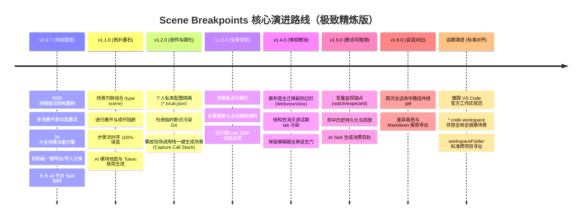

# Scene Breakpoints 功能演进路线图 (Roadmap)

> **核心定位**：轻量级场景化断点编排器，专为**代码研读、执行链路追踪与 AI Agent 协同**打造。  
> 本文档坚持极简主义与真实价值导向，摒弃任何形式的伪需求与功能镀金，汇总插件在完成 v1.0.7 基础底座（纯领域驱动 KDD 重构、多场景并发激活、34 大极限自愈引擎、剪贴板一键导出/导入分享、8 大平台 AI Skill 矩阵）后的核心演进主线。

---

## 目录

- [一、核心演进里程碑一览 (Milestones Overview)](#一核心演进里程碑一览-milestones-overview)
- [二、v1.1.0 数据与拓扑基石 (Data & Composition)](#二v110-数据与拓扑基石-data--composition)
  - [1. 场景组合与内联引用引擎 (Scene Composition with `type: "scene"`)](#1-场景组合与内联引用引擎-scene-composition-with-type-scene)
  - [2. AI 模块地图规则升级 (AI Architectural Map)](#2-ai-模块地图规则升级-ai-architectural-map)
- [三、v1.2.0 团队协作与现场固化 (Collaboration & Retention)](#三v120-团队协作与现场固化-collaboration--retention)
  - [3. 团队公共场景与个人私有配置隔离 (`*.local.json`)](#3-团队公共场景与个人私有配置隔离-localjson)
  - [4. 事故现场逆向固化：调用栈一键生成场景 (Capture Call Stack)](#4-事故现场逆向固化调用栈一键生成场景-capture-call-stack)
- [四、v1.3.0 全景视觉与动态画布 (Visual Graph & Map)](#四v130-全景视觉与动态画布-visual-graph--map)
  - [5. 场景断点可视化 (全景交互与跳转)](#5-场景断点可视化-全景交互与跳转)
- [五、v1.4.0 画布体验根治：副侧边栏伴随模式 (Canvas Companion v2)](#五v140-画布体验根治副侧边栏伴随模式-canvas-companion-v2)
  - [7. 画布宿主迁移：WebviewView 副侧边栏仪表盘](#7-画布宿主迁移webviewview-副侧边栏仪表盘)
- [六、v1.5.0 断点可观测性 (Observability)](#六v150-断点可观测性-observability)
  - [8. 变量监视锚点 (Watch Anchors)](#8-变量监视锚点-watch-anchors)
  - [9. 命中历史持久化与回放 (Hit History)](#9-命中历史持久化与回放-hit-history)
- [七、v1.6.0 调试会话对比 (Session Diff)](#七v160-调试会话对比-session-diff)
  - [10. 会话命中路径对比与报告导出](#10-会话命中路径对比与报告导出)
- [八、AI 协同增强：Skill 生成/消费双轨 (AI Collaboration)](#八ai-协同增强skill-生成消费双轨-ai-collaboration)
  - [11. AI Skill 质量规范 (Writer 质量标准)](#11-ai-skill-质量规范-writer-质量标准)
  - [12. 场景消费 Skill (scene-breakpoints-reader)](#12-场景消费-skill-scene-breakpoints-reader)
- [九、后置与边界 (Deferred & Non-Goals)](#九后置与边界-deferred--non-goals)
- [十、远期标准对齐：多根工作区全链路编排 (Multi-root Workspace Protocol)](#十远期标准对齐多根工作区全链路编排-multi-root-workspace-protocol)
  - [6. 深度契合 VS Code 官方标准的多根全链路场景](#6-深度契合-vs-code-官方标准的多根全链路场景)
- [十一、演进优先级矩阵 (Priority Matrix)](#十一演进优先级矩阵-priority-matrix)

---

## 一、核心演进里程碑一览 (Milestones Overview)



---

## 二、v1.1.0 数据与拓扑基石 (Data & Composition)

> **核心目标**：彻底解决断点重复定义，单工程内部实现无缝组合复用，并为 AI 提供低 Token 消耗的结构化项目地图。本阶段 100% 聚焦确定性领域逻辑，零外部标准依赖。

### 1. 场景组合与内联引用引擎 (Scene Composition with `type: "scene"`)
- **痛点背景**：
  - 目前每个场景均为独立的断点数组。通用断点（如鉴权拦截、公共 DB 查询）在多个业务场景中被反复复制定义。一旦代码重构行号漂移，需修改多处，极易遗漏；
  - 传统类似面向对象的 `extends: ["auth-core"]` 继承模式存在致命缺陷：它无法处理**真实的执行时序穿插**（例如：先鉴权 → 执行订单解析 → 再开启数据库事务 → 执行订单风控），且导致场景在“数组”与“对象”间分裂。
- **架构实现（多态步骤流模型）**：
  - **100% 保持纯数组结构**：所有场景统一为一维有序步骤数组 `SceneItem[]`，将“子场景引用”与各类断点作为一等公民的**多态步骤节点（Discriminated Union）**：
    ```json
    {
      "scenes": {
        "auth-core": [
          { "type": "line", "file": "src/auth.ts", "line": 45, "desc": "权限校验" }
        ],
        "db-core": [
          { "type": "line", "file": "src/dao.ts", "line": 120, "desc": "SQL 事务开启" }
        ],
        "payment-debug": [
          { "type": "scene", "name": "auth-core", "desc": "步骤 1: 基础鉴权与 Token 校验" },
          { "type": "line", "file": "src/payment.ts", "line": 40, "desc": "步骤 2: 订单参数解析" },
          { "type": "scene", "name": "db-core", "desc": "步骤 3: 开启数据库事务" },
          { "type": "line", "file": "src/payment.ts", "line": 88, "desc": "步骤 4: 订单风控与库存预占" }
        ]
      }
    }
    ```
  - **核心领域解析器 (`src/domain/sceneResolver.ts`)**：
    - **时序因果 100% 保真**：从上往下遍历数组，遇到普通断点直接收集，遇到 `{ type: "scene", name: "..." }` 递归展开目标子场景，步骤前后顺序完全符合代码执行逻辑；
    - **成环拦截**：采用 DFS 递归与 `visited` 集合，遇到直接循环（`A -> A`）或间接多级循环（`A -> B -> C -> A`）抛出 `CircularReferenceError` 阻断激活；
    - **悬空降级**：遇到悬空引用（引用的子场景名不存在）记录轻量警告并跳过，正常下发其余断点，防调试会话中断；
    - **支持子场景级开关 (`enabled: false`)**：支持对整个子场景节点一键开启/禁用，跳过该引用的全量断点下发；
    - **面向未来的扩展性**：基于统一的 `BaseSceneItem { type: string }` 契约，解析器对于未来新增的 UI 分割线（`type: "section"`）、异常断点（`type: "exception"`）或未识别节点均支持优雅降级与分发，具备向前向后完全兼容能力；
  - **侧边栏 UI 树状投影**：树视图以折叠节点清晰展示嵌套子场景片段（`🔗 子场景: auth-core (1)`），点击引用标题支持直接跳转/聚焦至源场景。

---

### 2. AI 模块地图规则升级 (AI Architectural Map)
- **痛点背景**：
  - AI 生成新场景时只能从零生成全部断点，不仅消耗大量 Token，还容易漏掉项目基础链路。
- **架构实现**：
  - 子场景引用结构天然是一张结构化的“项目模块拓扑图”。
  - **生成阶段大幅省 Token**：AI 生成新排查链路时，先检索已有基础场景，直接声明 `{ "type": "scene", "name": "auth-core" }`，仅增量编写 1~2 个关键断点，Token 消耗减少 60%+；
  - **推理阶段直接洞察**：回答“支付与登录流程有什么公共逻辑”时，AI 直接根据场景引用依赖关系秒级推理，无需全盘扫码。

---

## 三、v1.2.0 团队协作与现场固化 (Collaboration & Retention)

> **核心目标**：轻快聚焦于日常协作中真正的硬刚需——杜绝个人调试断点污染 Git 仓库，以及突发 Bug 现场调用栈一键固化。

### 3. 团队公共场景与个人私有配置隔离 (`*.local.json`)
- **痛点背景**：
  - 团队将标准的业务排查场景提交到 Git（`debug-scenes.json`）。开发者排查临时 Bug 时随手新建了 `temp-test` 等临时断点，提交 Git 时一不小心便会污染代码库。
- **架构实现**：
  - 引入分层配置文件机制：
    - `.vscode/debug-scenes.json`（**团队公共场景**，纳入 Git 版本管理）；
    - `.vscode/debug-scenes.local.json`（**个人私有场景**，插件初始化时自动加入 `.gitignore`）；
  - 侧边栏统一聚合加载，开发者既可随时引用团队公共库，又可自由创建个人专属调试场景，彻底杜绝 Git 污染。

---

### 4. 事故现场逆向固化：调用栈一键生成场景 (Capture Call Stack)
- **痛点背景**：
  - 发生异常或断点暂停时，当前线程的调用栈（Call Stack）横跨了多个关键函数。调试一旦终止，事故现场立刻丢失。
- **架构实现**：
  - 调试暂停时，右键提供：`Scene: 将当前调用栈保存为场景断点`；
  - 自动从 DAP 拉取当前堆栈帧，逆向固化为带步骤、带代码指纹的全新场景，瞬态 Bug 秒变工程资产。

---

## 四、v1.3.0 全景视觉与动态画布 (Visual Graph & Map)

> **核心目标**：跳出传统一维列表的限制，提供图形化全景空间感，支持直接点击节点跳转源码以及运行期动态追踪。

### 5. 场景断点可视化 (全景交互与跳转)
- **痛点背景**：
  - 当排查链路跨越多个文件和模块时，一维断点列表无法呈现清晰的空间结构与流向。
- **核心机制**（基于 VS Code 内置 Webview 画布）：
  - **全景图表展示**：直观展现实体依赖与流转关系（具体呈现形式在实施阶段做专项原型设计评测，保持架构弹性）；
  - **点击直达源码**：点击画布上的任意步骤节点，VS Code 编辑器自动平滑滚动高亮目标代码行（自然替代并超越了单纯快捷键盲翻代码的模式）；
  - **运行期动态点亮 (Live DAP Tracking)**：
    - 调试暂停命中断点时，画布对应节点高亮脉冲闪烁，直观感知当前执行进度；
  - **一键图表导出**：支持导出为标准 Mermaid 流程图或 SVG，便于贴入 PR 审阅与技术文档。

---

## 五、v1.4.0 画布体验根治：副侧边栏伴随模式 (Canvas Companion v2)

> **核心目标**：根治调试期编辑器 tab 污染——画布从"编辑器 tab"迁出为"副侧边栏仪表盘"，结构性消灭 tab 竞争，而非用锁定组等手段打补丁。

### 7. 画布宿主迁移：WebviewView 副侧边栏仪表盘
- **痛点背景**：
  - 画布当前以 `WebviewPanel` 编辑器 tab 形态驻留编辑器组（伴随模式默认 `Beside` 分栏）。DAP 断点命中时，VS Code 将源码文件打开到活动编辑器组（常与画布同组），调试过程中画布旁不断堆积源码 tab，伴随体验被破坏；
  - 既有跨分栏防遮挡策略（`resolveTargetSourceColumn`）只解决"点击跳源码"，无法阻止调试器自身的开 tab 行为。
- **核心机制**：
  - **宿主形态迁移**：画布宿主从 `WebviewPanel`（编辑器 tab）迁移为 `WebviewView`（副侧边栏 Secondary Side Bar，与调试控制台同区域），结构上永不产生 tab、永不被调试源码挤占；
  - **前端资产全量复用**：webview 前端消息协议、图渲染与交互逻辑保持不变，仅替换宿主桥接层与视图贡献点（`viewsContainers`/`views`）；
  - **响应式布局适配**：窄栏下的图布局与交互降级策略（折叠侧栏、缩放阈值）；
  - **全屏分析逃生门**：画布工具栏保留"在编辑器中打开"按钮，按需以 `WebviewPanel` 打开全屏分析模式，该路径建议配合"固定 + 锁定组"使用；
  - **防遮挡策略保留**：编辑器打开模式下 `resolveTargetSourceColumn` 跨分栏策略继续生效。
- **明确不做**：主侧边栏塞图（空间过窄）、独立窗口模式。

---

## 六、v1.5.0 断点可观测性 (Observability)

> **核心目标**：把"调试现场"从瞬态变为数据资产，为回放、对比与 AI 协同提供数据源。两项能力纯增量交付，零破坏存量功能。

### 8. 变量监视锚点 (Watch Anchors)
- **痛点背景**：断点处观察变量需手动输入 Watch 面板；同一组变量在多个断点重复输入；没有"期望值 vs 实际值"对比。
- **核心机制**：`SceneBreakpoint` 新增可选 `watch: string[]` 与 `expected` 字段；断点命中时经 DAP evaluate 只读采集变量值，与期望对比异常高亮，结果并入命中历史。
- **设计红线（不变量）**：
  - **Schema 只增不改**：新字段全部可选，旧配置文件零迁移；
  - **指纹锚点输入不变**：`pureSha256` 指纹计算不纳入 `watch`/`expected`，杜绝全量指纹漂移与自愈误判；
  - **命中管线降级安全**：变量缺失或求值失败静默降级为"未采集"，绝不阻断激活与命中记录主流程。

### 9. 命中历史持久化与回放 (Hit History)
- **痛点背景**：调试结束后，命中顺序与调用栈现场全部丢失；间歇性 Bug 无法跨会话对比两次执行差异。
- **核心机制**：监听 DAP stopped 事件流（v1.3.0 `TraceRecord` 管线全量复用），持久化断点命中序列与顶层调用帧；侧边栏新增"调试历史"视图回放命中路径，并与画布时间线联动。
- **隐私红线**：历史默认落 `.vscode/debug-history.local.json`（自动 gitignore，沿用 `*.local.json` 分层模式）；变量快照按会话 opt-in；历史文件滚动上限（保留最近 N 次会话）。

---

## 七、v1.6.0 调试会话对比 (Session Diff)

> **核心目标**：修复 Bug 后直观验证"修复真的生效"，无需人工记忆对比。

### 10. 会话命中路径对比与报告导出
- **痛点背景**：修复后无法直观确认修复生效，需人工对比两次调试的执行路径与变量值。
- **核心机制**：基于命中历史，将两次会话的命中路径并排对比，用可视化画布渲染差异高亮（依赖稳定节点 id `{ownerScene}#{index}`），支持导出 Markdown 报告。
- **依赖**：命中历史持久化（§9）先行交付。

---

## 八、AI 协同增强：Skill 生成/消费双轨 (AI Collaboration)

> **核心目标**：补齐核心定位"代码研读"在 AI 层的缺口——现有 8 平台 Skill 矩阵全部生成向（读代码 → 写 JSON），场景作为"项目模块拓扑图"的消费侧价值（读场景 → 按图索骥理解代码）未被 Skill 层承接。本批次纯文档/Skill 变更，零运行时代码，可随任一版本提前交付。

### 11. AI Skill 质量规范 (Writer 质量标准)
- **痛点背景**：AI 生成场景质量参差，`desc: "第 45 行"` 与 `desc: "检查 user 是否为 null"` 对消费侧的价值差一个量级。
- **核心机制**：Skill 中明确写出质量标准 + few-shot 示例：`desc` 写"观察意图"不写位置；场景说明写清覆盖链路；断点按执行顺序排列；关键分支用 `type: "condition"` 显式表达。
- **边界**：不做强制校验（AI 生成是建议性，不是契约）。

### 12. 场景消费 Skill (scene-breakpoints-reader)
- **痛点背景**：用户请求理解代码/追踪流程时，AI 不知道场景文件的存在，或全量硬读 JSON 烧 Token。
- **核心机制（读图四步法）**：
  - **存在性探测前置**：先廉价探测场景文件是否存在（不存在或与任务无关立即放弃，防过触发）；
  - **相关性判断**：按场景 `desc` 与引用结构判断与当前任务的相关性；
  - **按需展开**：需要深入时展开 `type: "scene"` 引用；
  - **精准读取**：只读断点指向位置（file + line 附近），不全文扫描。
- **回答组织原则**：用场景组织回答而非用代码组织回答——先给出关键节点清单（desc + file:line），让用户选择深入哪一步。
- **协作闭环**：场景覆盖不足时**建议**用户生成新场景，用户确认后转 writer Skill（human-in-the-loop），禁止硬答、禁止自动转生成。
- **边界**：writer 保留现有 Skill 名称（避免 8 平台安装迁移成本），reader 为新增；复用各平台 shared-core 结构，避免 2×8 份全文维护。

---

## 九、后置与边界 (Deferred & Non-Goals)

- **后置（触发条件制）**：
  - **多文件场景管理**（`.vscode/debug-scenes/` 目录约定扫描）：解决 Git 冲突与模块职责问题，但涉及单写者队列文件感知路由、防回环基线多文件播种、迁移改名联动（`activeScenes`/`bindings` 同步改写），属破坏性前置工程。**触发条件**：团队协作 Git 冲突痛点真实放大；**实施前提**：先出 ADR 裁决合并模型与个人层（INV-032）边界。
- **明确不做**：
  - 场景模板库（AI Skill 已能动态生成，静态模板冗余）；
  - 跨编辑器配置同步（场景文件属项目资产，与编辑器无关）；
  - 分支绑定场景（Git 已解决）、场景版本历史（Git 已解决）；
  - 索引表（违反"约定优于配置"，需人肉维护）。
- **探索观察（不进路线）**：
  - 场景共享市场（零服务器 GitHub 索引，冷启动依赖多文件管理；需解决第三方场景 `condition`/`logMessage` 副作用信任门禁）；
  - 调试会话录制与回放（事件序列化/状态同步/回放时序成本高，命中历史已覆盖主要价值）；
  - 场景驱动测试生成（调试断点位置 ≠ 契约测试点，价值待验证）。

---

## 十、远期标准对齐：多根工作区全链路编排 (Multi-root Workspace Protocol)

> **战略决策**：坚决避免自研私有工作区文件协议。将此需求后置，紧密跟踪 VS Code 官方多根工作区与 Agent/Skill 标准演进，成熟时顺水推舟、无缝对齐官方原生规范实现。

### 6. 深度契合 VS Code 官方标准的多根全链路场景
- **官方成熟规范对齐**：
  - **宿主文件标准**：工作区全局场景绝不在磁盘上另起炉灶，严格依照 VS Code 原生规范存放在 `*.code-workspace` 的 `settings["sceneBreakpoints.scenes"]` 中，调用官方 API 原生读写；
  - **跨工程寻址标准**：统一采用官方标准宏 `${workspaceFolder:folderName}/path/to/file` 进行稳定定位；
  - **引用语法统一**：工作区场景跨项目组装时，无缝沿用 `{ "type": "scene", "folder": "featron", "name": "video-pipeline" }`；
- **启动时机**：待 VS Code 官方多根 Workspace 指令与上下文标准全面普及收敛后，正式实施。

---

## 十一、演进优先级矩阵 (Priority Matrix)

| 里程碑 | 核心特性 | 价值定位 | 涉及架构分层 |
| :--- | :--- | :--- | :--- |
| **v1.1.0**<br>*(已交付)* | **① 场景组合与内联引用 (`type: "scene"`)**<br>**② AI 模块地图规则升级** | 消除断点冗余、时序因果 100% 保真、大幅节约 AI 生成/推理 Token | `src/domain/sceneResolver.ts`<br>`src/infra/storage/`<br>`src/infra/vscode/`<br>`skills/` |
| **v1.2.0**<br>*(已交付 2026-10-07)* | **③ 个人私有配置隔离 (`*.local.json`)**<br>**④ 事故调用栈一键生成场景 (Capture Call Stack)** | 杜绝临时断点污染 Git 仓库、瞬态 Bug 现场一键固化沉淀 | `src/infra/storage/`<br>DAP 适配器 |
| **v1.3.0**<br>*(已交付 2026-10-07)* | **⑤ 场景断点可视化 (Visual Graph & Map)** | 建立时空全景感知、点击节点直接跳转源码、运行期状态脉冲追踪 | VS Code Webview Provider<br>状态机与监听器 |
| **v1.4.0**<br>*(规划中)* | **⑦ 画布体验根治：副侧边栏伴随模式 (Canvas Companion v2)** | 结构性消灭调试期 tab 污染，画布成为常驻调试仪表盘 | VS Code WebviewView<br>webview 前端复用 |
| **v1.5.0**<br>*(规划中)* | **⑧ 变量监视锚点 (Watch Anchors)**<br>**⑨ 命中历史持久化与回放 (Hit History)** | "期望 vs 实际"可观测、调试现场资产化、跨会话可回放 | DAP evaluate<br>领域历史存储<br>侧边栏新视图 |
| **v1.5.x**<br>*(规划中·纯文档可提前)* | **⑪ AI Skill 质量规范 (Writer 质量标准)**<br>**⑫ 场景消费 Skill (scene-breakpoints-reader)** | 补齐"代码研读"在 AI 层的缺口，场景成为 AI 的项目导航地图 | `skills/` 各平台 shared-core |
| **v1.6.0**<br>*(规划中)* | **⑩ 调试会话对比 (Session Diff)** | 修复效果可视化验证、Markdown 报告沉淀 | 画布 diff 渲染<br>历史数据消费 |
| **后置**<br>*(触发条件制)* | **多文件场景管理**（先出 ADR） | 解决 Git 冲突与模块职责，属破坏性前置工程 | 单写者队列文件感知<br>防回环基线播种<br>迁移命令 |
| **远期演进**<br>*(对齐官方标准)* | **⑥ 多根工作区全链路场景编排** | 遵照 VS Code 原生 `*.code-workspace` 与 `${workspaceFolder:name}` 规范，实现跨工程无痛编排 | VS Code Configuration API<br>多根扫描引擎 |

---
*文档更新于 2026-10-12。坚持极简主义与真实价值导向，先设计契约，后交付实现。*
